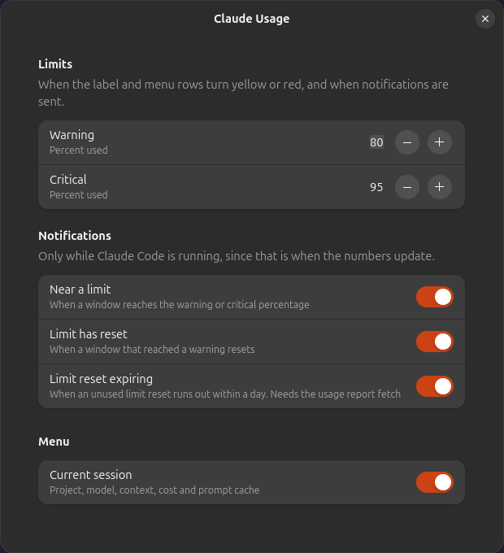
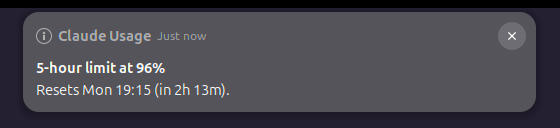

# Claude Usage for GNOME

[](https://github.com/BardsWork/claude-usage-gnome/actions/workflows/test.yml)
[](https://www.gnome.org/)
[](LICENSE)

A GNOME Shell extension that shows your Claude Pro or Max plan usage in the top bar, so you can see how close you are to your limits without running `/usage` in Claude Code.


- **No API key, no login.** The extension only reads files that Claude Code's status line writes.
- **Warns you early.** The label turns yellow and red as you near a limit, each row says whether you're using it faster than it refills, and notifications tell you when you cross a threshold or a limit resets.
- **Everything `/usage` shows**, and a bit more, if you turn on the optional [usage report fetch](#the-optional-usage-report-fetch).

## What it shows

The label shows your **5-hour** window, then your **weekly** limit. It turns yellow at 80% and red at 95%. You can change both [in the settings](#settings-and-notifications).

Click it for the menu:

| Row | What it tells you | Needs the usage report fetch |
|---|---|:-:|
| **5-hour**, **Weekly** | Percent used, when it resets, and your [pace](#pace). The limit that applies right now is bold. | |
| **Weekly by surface** | Where this week's usage went: Claude Code, chats, Cowork | ✓ |
| **Fable weekly** | Fable's own weekly limit, and how much of your weekly limit it may use (`7% of weekly, cap 50%`) | ✓ |
| **Limit resets** | Resets you can use with `/limit-reset`, and when they run out. Says when you're at a limit and can use one. | ✓ |
| **Extra usage** | What you've spent on extra usage this month, when it's turned on | ✓ |
| **Current session** | Project, model, context used and cost at API prices, for the session that refreshed last | |
| **Prompt cache** | How long that session's prompt cache stays warm, and its hit rate | |
| **Updated** | How old the numbers are | |

Rows without data are hidden. The label dims when its numbers are more than 15 minutes old, and the rows from the usage report dim when it's more than 30 minutes old.

### Pace

Pace compares how much of a window you've used with how much of it has passed. 40% used halfway through the week is `below pace`. Above pace, the row also says when you'd hit the limit at that rate, for example `above pace, limit around Wed 18:20`. It shows nothing in the first 10% of a window, while the rate is still noise.

### Current session

`my-app · Opus 5.5 · context 16% of 1M · $4.70 at API prices` is the Claude Code session that refreshed the status line last. On a Pro or Max plan you don't pay that cost: it's what the same work would cost through the API. With several sessions open, it's whichever refreshed last. You can hide these rows in the settings.

## Install

You need GNOME Shell 50 and Claude Code signed in with a Pro or Max subscription. The usage report fetch also needs `curl` and `jq`.

1. Clone the repo:

   ```bash
   git clone https://github.com/BardsWork/claude-usage-gnome.git ~/claude-usage-gnome
   ```

2. Make your Claude Code status line script run the snippet. Add this line right after the script reads stdin into `$data`:

   ```bash
   source ~/claude-usage-gnome/statusline-snippet.sh
   ```

   Sourcing it, rather than copying it in, means `git pull` updates it too. The snippet saves the status line JSON and runs the optional [usage report fetch](#the-optional-usage-report-fetch). To leave the fetch out, copy only the snippet's first two commands instead.

   <details>
   <summary>No status line script yet?</summary>

   Save this as `~/.claude/statusline.sh` and make it executable with `chmod +x ~/.claude/statusline.sh`:

   ```bash
   #!/bin/bash
   data=$(cat)
   source ~/claude-usage-gnome/statusline-snippet.sh
   # What Claude Code shows in its own status line (needs jq)
   echo "$data" | jq -r '.model.display_name'
   ```

   Then point Claude Code at it in `~/.claude/settings.json`:

   ```json
   {
     "statusLine": { "type": "command", "command": "~/.claude/statusline.sh" }
   }
   ```

   See the [status line docs](https://docs.claude.com/en/docs/claude-code/statusline) for more.

   </details>

3. Install the extension:

   ```bash
   cd ~/claude-usage-gnome && ./install.sh
   ```

   This compiles the settings schema, symlinks `claude-usage@bardswork` into `~/.local/share/gnome-shell/extensions/`, and enables it.

4. Log out and back in. On Wayland, GNOME only finds new extensions at login.

Check that it loaded with `gnome-extensions info claude-usage@bardswork`, which should say `State: ACTIVE`. Numbers appear the next time Claude Code refreshes its status line. If it says `ERROR`, or the label stays at `Claude –`, see [Troubleshooting](docs/troubleshooting.md).

## Settings and notifications

Click **Settings** at the bottom of the menu, or run `gnome-extensions prefs claude-usage@bardswork`.



The extension sends a notification:

- when a window reaches the warning or critical percentage, once per level
- when a window that reached a warning resets
- when an unused limit reset runs out within a day



It only notifies about fresh numbers, and never about limits you had already reached before logging in.

## How it works

```
Claude Code ──status line JSON──▶ your status line script ──▶ ~/.cache/claude-usage/statusline.json ──┐
                                        │                                                          ├──▶ extension (reads every 30 s)
                                        └── optional fetch, every 5 min ──▶ ~/.cache/claude-usage/usage.json ──┘
```

Claude Code passes a JSON object to your [status line](https://docs.claude.com/en/docs/claude-code/statusline) script every time the status line refreshes. It includes `rate_limits`, the same 5-hour and weekly percentages `/usage` shows, plus the model, context and cost of the session. The snippet saves it, and the extension reads the file every 30 seconds.

So the numbers only update while Claude Code is running. Usage from claude.ai or the desktop app shows up the next time Claude Code refreshes. After a window's reset time passes, it shows 0% until Claude Code reports again.

### The optional usage report fetch

Some things aren't in the status line JSON: the Fable window, where your usage went, limit resets, extra usage, and the server's own view of how close you are to each limit. They're in the usage report that `/usage` reads from `https://api.anthropic.com/api/oauth/usage`. The second part of the snippet fetches it in the background, at most every 5 minutes, and saves it to `~/.cache/claude-usage/usage.json`.

- It uses the sign-in Claude Code saves in `~/.claude/.credentials.json`, and sends it only to Anthropic's API, in the same request Claude Code makes for `/usage`. The token never shows up in the process list or in a file.
- It sends Claude Code's User-Agent (`claude-cli/<version>`), because the server only includes limit resets for Claude Code. It never uses a reset: only `/limit-reset` in Claude Code does that.
- Limit resets come from an undocumented part of the report (`cedar_ember`), so they may change or stop showing up. If they do, the row just stays hidden.

### What leaves your machine

The extension itself makes no network requests. The only request is the optional fetch above, from your status line script to Anthropic, with your own Claude Code sign-in. Leave out that part of the snippet and nothing leaves your machine.

## Update

```bash
cd ~/claude-usage-gnome && git pull && ./install.sh
```

Then log out and back in. Running `./install.sh` again recompiles the settings schema, which an update may have changed.

## Uninstall

```bash
gnome-extensions disable claude-usage@bardswork
rm ~/.local/share/gnome-shell/extensions/claude-usage@bardswork
rm -r ~/.cache/claude-usage
```

Then remove the `source` line from your status line script.

## Docs

- [Troubleshooting](docs/troubleshooting.md): no data, dimmed rows, missing rows, `ERROR` or `OUT OF DATE` state, other GNOME versions
- [Development](docs/development.md): code layout, tests, testing in a nested shell, screenshots, packaging
- [Contributing](CONTRIBUTING.md)
- [Changelog](CHANGELOG.md)

Tested with GNOME Shell 50 on Ubuntu 26.04 and Claude Code 2.1.325. Versions of GNOME Shell from 45 on may work: add them to `shell-version` in `metadata.json` and test.

## License

MIT. See `LICENSE`.

Not affiliated with or endorsed by Anthropic. Claude is a trademark of Anthropic, PBC.
