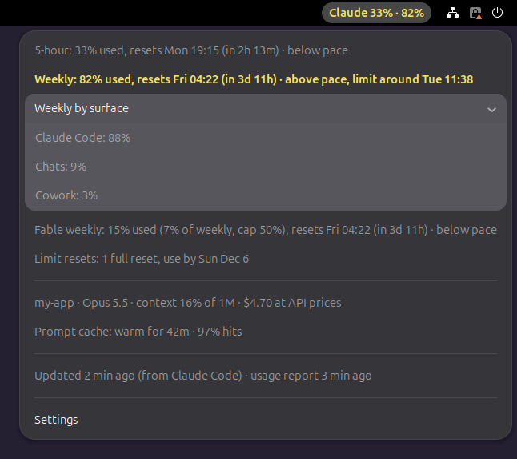

# Claude Usage for GNOME

[](https://github.com/BardsWork/claude-usage-gnome/actions/workflows/test.yml)
[](https://www.gnome.org/)
[](LICENSE)

A GNOME Shell extension that shows your Claude Pro or Max plan usage in the top bar, so you can see how close you are to your rate limits without running `/usage` in Claude Code.



The first number is your 5-hour session window. The second is your weekly limit. The label turns yellow at 80% and red at 95%. Click it to see when each one resets, whether you're using it faster than it refills, and how old the numbers are.

If you turn on the [usage report fetch](#fable-weekly-limit-optional), the menu also has your Fable weekly limit, any limit resets you have left to use, and where your weekly usage went (Claude Code, chats, Cowork). The label then also turns yellow when the server marks a limit as anything other than normal, and the limit that applies right now is shown in bold.

### Pace

Each row says whether you're below, on, or above pace: your % used against the % of the window that has passed. Above pace, it also says when you'd hit the limit at that rate, for example `above pace, limit around Wed 18:20`. It shows nothing in the first 10% of a window, where the rate is too noisy to mean much.

- No login, no API key, no network calls in the extension. It reads files that Claude Code's status line writes.
- About 100 lines of JavaScript, with unit tests and a headless GNOME Shell test.

## How it works

Claude Code passes a JSON object to your [status line](https://docs.claude.com/en/docs/claude-code/statusline) script every time the status line refreshes. That JSON includes a `rate_limits` field with the same percentages `/usage` shows:

```json
"rate_limits": {
  "five_hour": { "used_percentage": 33, "resets_at": 1792534800 },
  "seven_day": { "used_percentage": 63, "resets_at": 1792875600 }
}
```

Your status line script saves that JSON to `~/.cache/claude-usage/statusline.json`, and the extension reads the file every 30 seconds. It never touches your Claude login or calls any API.

Because of this:

- The numbers only update while a Claude Code session is running. If the file is more than 15 minutes old, the label dims.
- Usage from claude.ai or the desktop app shows up the next time Claude Code refreshes its status line.
- After a window's reset time passes, it shows 0% until Claude Code reports again.
- `rate_limits` only appears when Claude Code is signed in with a Claude subscription (Pro or Max), not with an API key.

### Fable weekly limit (optional)

The status line JSON has no Fable window. It's only in the usage report that `/usage` reads from `https://api.anthropic.com/api/oauth/usage`. The second part of `statusline-snippet.sh` fetches that report, at most once every 5 minutes, using the OAuth token Claude Code saves in `~/.claude/.credentials.json`, and saves it to `~/.cache/claude-usage/usage.json`. The extension adds a "Fable weekly" row with its reset time to the menu when the file has one.

- It needs `curl` and `jq`, and runs in the background so the status line never waits for it.
- The token is only sent to Anthropic's API, the same request Claude Code makes for `/usage`. It doesn't go through the process list or into any file.
- If you don't want this, leave out that part of the snippet. The menu then has no Fable row and everything else works as before.
- Like the rest, it only updates while Claude Code is running.

### Limit resets (optional)

The same fetch also asks for the limit resets that Claude Code's `/limit-reset` command uses. When you have one left, the menu shows a row such as `Limit resets: 1 full reset, use by Thu Dec 10`, and hides it when you have none.

- These come from an undocumented part of the usage report (`cedar_ember`), so they may change or stop showing up. If they do, the row just stays hidden.
- The server only lists them for requests that send Claude Code's User-Agent, so the snippet sends `claude-cli/<version>`, with the version taken from the status line JSON.
- The extension only shows your resets. It never uses one. To use one, run `/limit-reset` in Claude Code.

## Requirements

- GNOME Shell 50 (tested on Ubuntu 26.04). Other versions from 45 on may work: add them to `shell-version` in `metadata.json` and test.
- Claude Code signed in with a Pro or Max subscription, with a status line script. Tested with version 2.1.302.

## Install

1. Clone the repo:

   ```bash
   git clone https://github.com/BardsWork/claude-usage-gnome.git
   cd claude-usage-gnome
   ```

2. Add the lines from `statusline-snippet.sh` to your status line script, right after it reads stdin into `$data`. The first two save the status line JSON. The block after them is the optional [Fable fetch](#fable-weekly-limit-optional).

   If you don't have a status line script yet, this one works. Save it as `~/.claude/statusline.sh` and make it executable with `chmod +x`:

   ```bash
   #!/bin/bash
   data=$(cat)
   mkdir -p "$HOME/.cache/claude-usage"
   printf '%s' "$data" > "$HOME/.cache/claude-usage/statusline.json"
   # What Claude Code shows in its own status line (needs jq)
   echo "$data" | jq -r '.model.display_name'
   ```

   Then point Claude Code at it in `~/.claude/settings.json`:

   ```json
   {
     "statusLine": { "type": "command", "command": "~/.claude/statusline.sh" }
   }
   ```

   See the [status line docs](https://docs.claude.com/en/docs/claude-code/statusline) for more.

3. Link and enable the extension:

   ```bash
   ./install.sh
   ```

   This symlinks `claude-usage@bardswork` into `~/.local/share/gnome-shell/extensions/`, so edits in this folder are what GNOME runs, and adds it to GNOME's enabled extensions.

4. Log out and back in. On Wayland, GNOME only finds new extensions at login.

To check it loaded:

```bash
gnome-extensions info claude-usage@bardswork    # State: ACTIVE
```

If it shows `ERROR`, or the label says `Claude –`, see [Troubleshooting](docs/troubleshooting.md).

## Uninstall

```bash
gnome-extensions disable claude-usage@bardswork
rm ~/.local/share/gnome-shell/extensions/claude-usage@bardswork
```

Then remove the snippet from your status line script, and delete `~/.cache/claude-usage`.

## Docs

- [Troubleshooting](docs/troubleshooting.md): no data, dimmed label, `ERROR` or `OUT OF DATE` state, other GNOME versions
- [Development](docs/development.md): code layout, tests, testing changes in a nested shell, packaging
- [Contributing](CONTRIBUTING.md)
- [Changelog](CHANGELOG.md)

## Tests

```bash
TZ=UTC gjs -m tests/usage.test.js    # unit tests
tests/headless.sh                    # loads the extension in a headless GNOME Shell
```

See [Development](docs/development.md#tests) for details.

## License

MIT. See `LICENSE`.

Not affiliated with or endorsed by Anthropic. Claude is a trademark of Anthropic, PBC.
