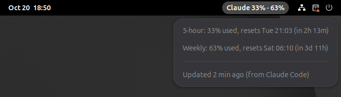

# Claude Usage for GNOME

[](https://github.com/BardsWork/claude-usage-gnome/actions/workflows/test.yml)
[](https://www.gnome.org/)
[](LICENSE)

A GNOME Shell extension that shows your Claude Pro or Max plan usage in the top bar, so you can see how close you are to your rate limits without running `/usage` in Claude Code.



The first number is your 5-hour session window. The second is your weekly limit. Click it to see when each one resets and how old the numbers are.

- No login, no API key, no network calls. It reads a file that Claude Code's status line writes.
- About 100 lines of JavaScript, with unit tests and a headless GNOME Shell test.

## How it works

Claude Code passes a JSON object to your [status line](https://docs.claude.com/en/docs/claude-code/statusline) script every time the status line refreshes. That JSON includes a `rate_limits` field with the same percentages `/usage` shows:

```json
"rate_limits": {
  "five_hour": { "used_percentage": 33, "resets_at": 1792534800 },
  "seven_day": { "used_percentage": 63, "resets_at": 1792875600 }
}
```

Your status line script saves that JSON to `~/.cache/claude-usage/statusline.json`, and the extension reads the file every 30 seconds. It never touches your Claude login or calls any API.

Because of this:

- The numbers only update while a Claude Code session is running. If the file is more than 15 minutes old, the label dims.
- Usage from claude.ai or the desktop app shows up the next time Claude Code refreshes its status line.
- After a window's reset time passes, it shows 0% until Claude Code reports again.
- `rate_limits` only appears when Claude Code is signed in with a Claude subscription (Pro or Max), not with an API key.

## Requirements

- GNOME Shell 50 (tested on Ubuntu 26.04). Other versions from 45 on may work: add them to `shell-version` in `metadata.json` and test.
- Claude Code signed in with a Pro or Max subscription, with a status line script. Tested with version 2.1.302.

## Install

1. Clone the repo:

   ```bash
   git clone https://github.com/BardsWork/claude-usage-gnome.git
   cd claude-usage-gnome
   ```

2. Add the two lines from `statusline-snippet.sh` to your status line script, right after it reads stdin into `$data`.

   If you don't have a status line script yet, this one works. Save it as `~/.claude/statusline.sh` and make it executable with `chmod +x`:

   ```bash
   #!/bin/bash
   data=$(cat)
   mkdir -p "$HOME/.cache/claude-usage"
   printf '%s' "$data" > "$HOME/.cache/claude-usage/statusline.json"
   # What Claude Code shows in its own status line (needs jq)
   echo "$data" | jq -r '.model.display_name'
   ```

   Then point Claude Code at it in `~/.claude/settings.json`:

   ```json
   {
     "statusLine": { "type": "command", "command": "~/.claude/statusline.sh" }
   }
   ```

   See the [status line docs](https://docs.claude.com/en/docs/claude-code/statusline) for more.

3. Link and enable the extension:

   ```bash
   ./install.sh
   ```

   This symlinks `claude-usage@bardswork` into `~/.local/share/gnome-shell/extensions/`, so edits in this folder are what GNOME runs, and adds it to GNOME's enabled extensions.

4. Log out and back in. On Wayland, GNOME only finds new extensions at login.

To check it loaded:

```bash
gnome-extensions info claude-usage@bardswork    # State: ACTIVE
```

If it shows `ERROR`, or the label says `Claude –`, see [Troubleshooting](docs/troubleshooting.md).

## Uninstall

```bash
gnome-extensions disable claude-usage@bardswork
rm ~/.local/share/gnome-shell/extensions/claude-usage@bardswork
```

Then remove the two lines from your status line script.

## Docs

- [Troubleshooting](docs/troubleshooting.md): no data, dimmed label, `ERROR` or `OUT OF DATE` state, other GNOME versions
- [Development](docs/development.md): code layout, tests, testing changes in a nested shell, packaging
- [Contributing](CONTRIBUTING.md)
- [Changelog](CHANGELOG.md)

## Tests

```bash
TZ=UTC gjs -m tests/usage.test.js    # unit tests
tests/headless.sh                    # loads the extension in a headless GNOME Shell
```

See [Development](docs/development.md#tests) for details.

## License

MIT. See `LICENSE`.

Not affiliated with or endorsed by Anthropic. Claude is a trademark of Anthropic, PBC.
